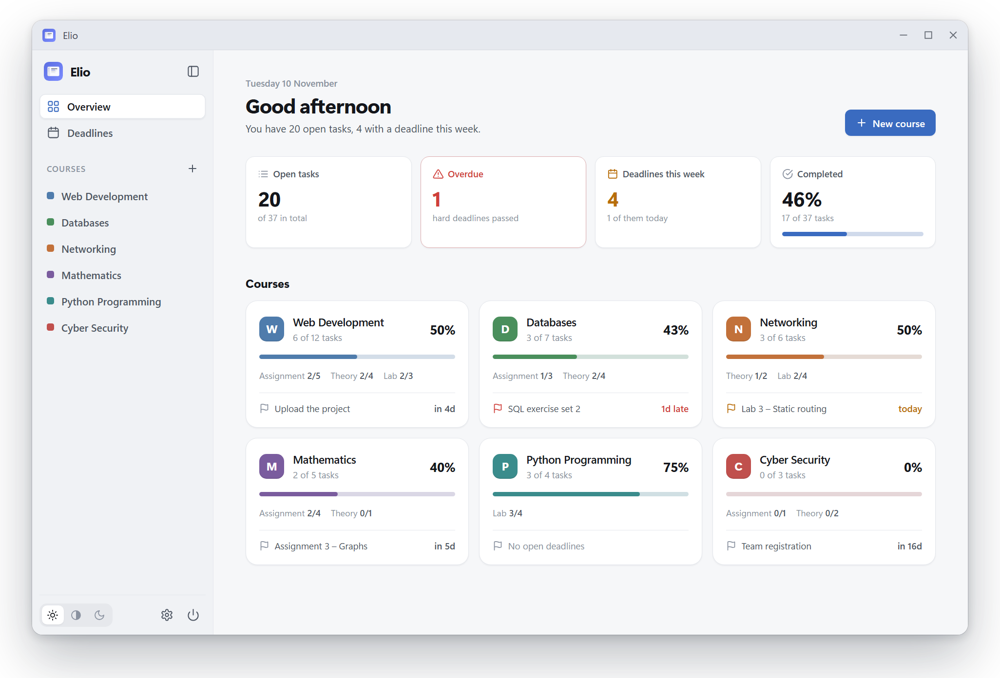
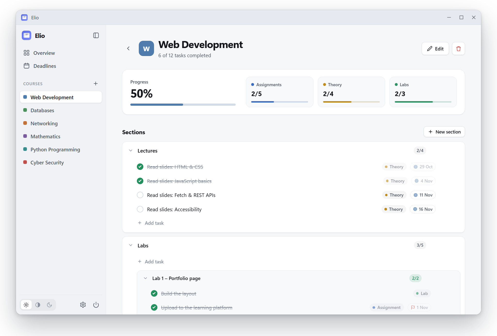
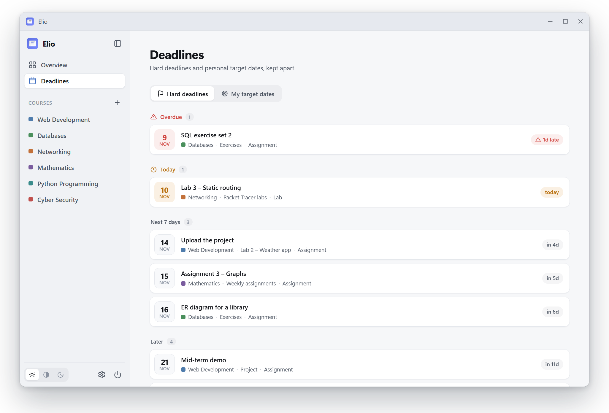
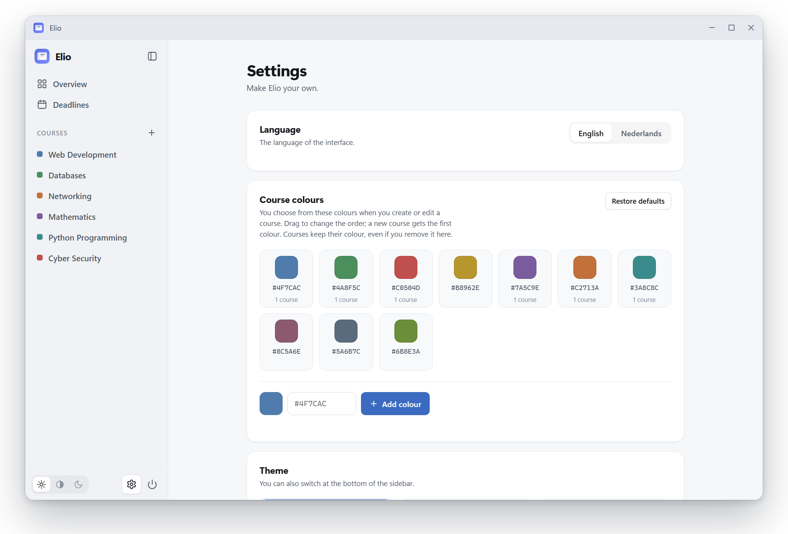
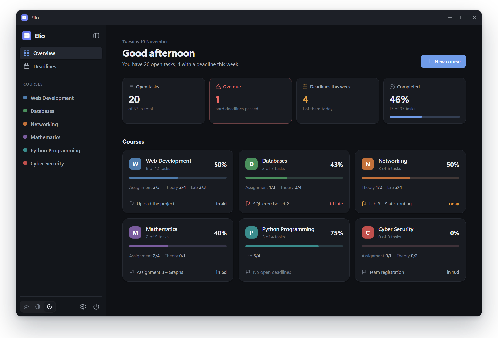

  

<h1 align="center">Elio</h1>

  <b>Your study planner: courses, tasks and deadlines in one calm overview.</b> 
  Free · Works offline · Your data stays on your computer

  
  &nbsp;
  

  <a href="https://github.com/penny707/Productivity-App/releases/latest">All downloads and release notes</a>

  

## What Elio does

<table>
  <tr>
    <td width="50%" valign="top">
      
      <h3>Plan every course</h3>
      Split a course into sections, such as chapters, labs or a project, and add tasks.
      Tick them off and watch your progress grow. Drag tasks to put them in order.
    </td>
    <td width="50%" valign="top">
      
      <h3>Never miss a deadline</h3>
      Every task can have a <b>hard deadline</b> and your own <b>target date</b>.
      Elio groups them into <i>overdue</i>, <i>today</i>, <i>next 7 days</i> and <i>later</i>.
    </td>
  </tr>
  <tr>
    <td width="50%" valign="top">
      
      <h3>Make it yours</h3>
      English or Dutch, your own colours for each course, and your courses in the
      order you like.
    </td>
    <td width="50%" valign="top">
      
      <h3>Easy on the eyes</h3>
      Choose a light, grey or dark theme. Elio opens in its own window, just like any
      other app.
    </td>
  </tr>
</table>

## Install

### Windows 10 and 11

1. **[Download Elio-Setup.exe](https://github.com/penny707/Productivity-App/releases/latest/download/Elio-Setup.exe)**.
   Your browser may warn that the file *"isn't commonly downloaded"*. In Edge, click
   **⋯** next to the download → **Keep** → **Show more** → **Keep anyway**. In Chrome,
   click **Keep**.
2. Open the file. Windows may say *"SmartScreen prevented an unrecognized app from
   starting"*. Click **More info**, then **Run anyway**.

   Both warnings appear because Elio is new and not yet widely downloaded. They're not
   about anything in the app.
3. Open **Elio** from the Start menu.

   > **Tip:** right-click Elio in the Start menu and choose *Pin to taskbar*.

### macOS (Apple Silicon: M1 or newer)

1. **[Download Elio-macOS.dmg](https://github.com/penny707/Productivity-App/releases/latest/download/Elio-macOS.dmg)**, open it and drag **Elio** into **Applications**.
2. The first time, macOS may say it can't check Elio. Open **System Settings →
   Privacy & Security**, scroll down and click **Open Anyway**.
3. Open **Elio** from Applications.

## Questions

<b>Is Elio really free? Does it need the internet?</b>

 
Yes, it's free and open source (<a href="LICENSE">MIT licence</a>). Elio works
completely offline: nothing is sent anywhere, and there's no account.

<b>Where is my data? What if something goes wrong?</b>

 

Everything is saved automatically on your own computer, and Elio makes **a backup
every day** (the last 14 are kept).

- **Windows:** `%APPDATA%\Elio` (paste this into the File Explorer address bar)
- **macOS:** `~/Library/Application Support/Elio`

To restore a backup:

1. Quit Elio with the power button at the bottom of the sidebar.
2. Copy a file from the `backups` folder into the `Elio` folder.
3. Rename it to `data.db`.

<b>How do I update or uninstall Elio?</b>

 
To update, download and install the newest version; your courses and tasks stay where
they are. To uninstall on Windows, go to <i>Settings → Apps → Installed apps → Elio</i>.
On a Mac, drag Elio from Applications to the Bin. Your data is kept in both cases.

<b>Can I use Elio without installing it?</b>

 
On Windows, yes: download the <b>portable zip</b> from the
<a href="https://github.com/penny707/Productivity-App/releases/latest">releases page</a>,
extract it anywhere and open <code>Elio.exe</code>.

## Coming soon

A **Today** view, **notes** on tasks, **backups** you can manage in Settings,
**semesters** with an archive, and **reminders** for upcoming deadlines.

---

  
    Built with the Python standard library and plain JavaScript, with no dependencies. 
    Curious how it works, or want to run it from source? See <a href="docs/DEVELOPMENT.md">docs/DEVELOPMENT.md</a>. 
    
  

